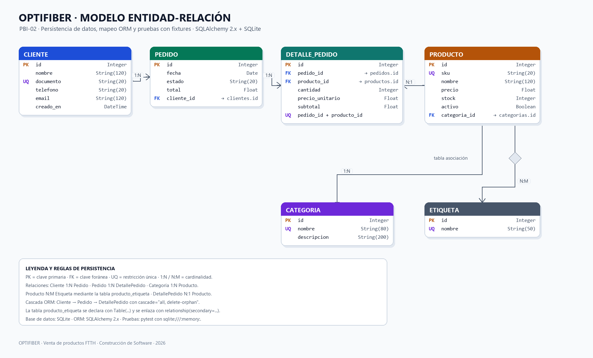
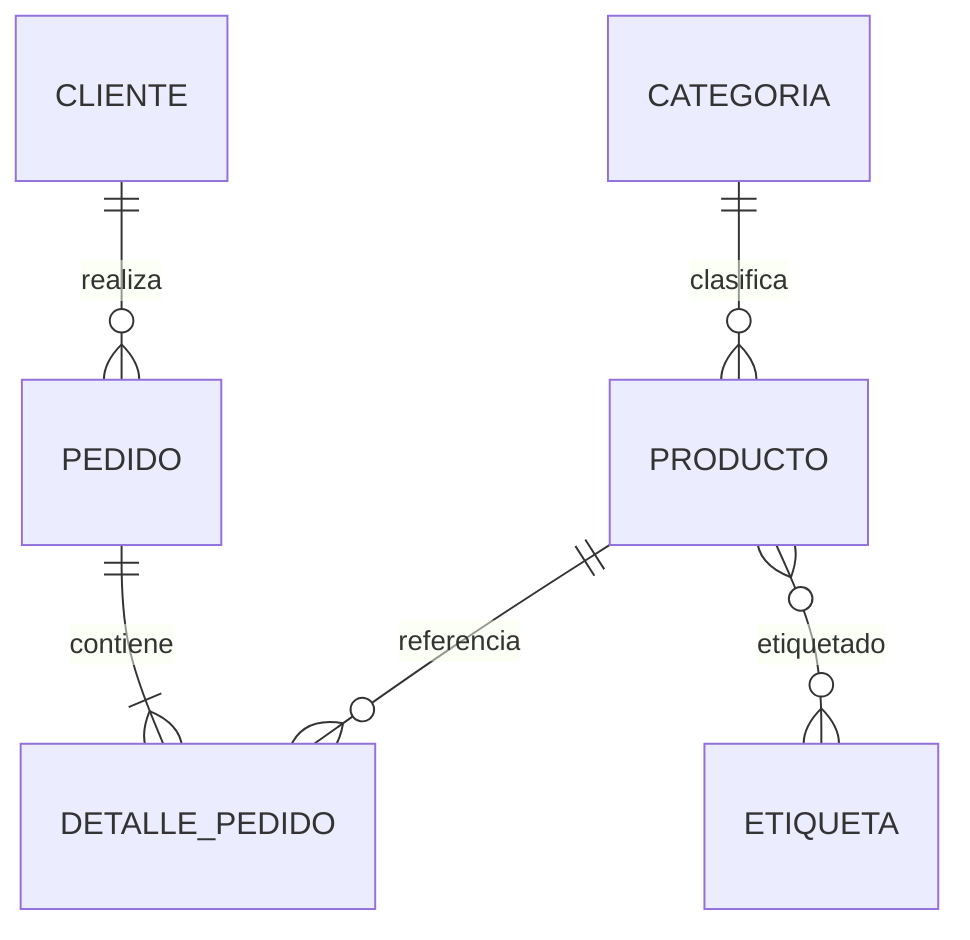

# OptiFiber FTTH · PBI-02

Sistema de gestión comercial para **OPTIFIBER**, empresa dedicada a la venta de productos FTTH (fibra óptica, equipos ONT/ONU, accesorios, herramientas y conectividad). El proyecto implementa la capa de persistencia con **SQLAlchemy 2.x**, relaciones **1:N y N:M**, **eliminación en cascada**, pruebas con **pytest** sobre **SQLite en memoria** y un pipeline de **GitHub Actions**.

> **Curso:** Construcción de Software  
> **Trabajo:** Instructivo de Trabajo Colaborativo N° 04 · Persistencia de Datos, Mapeo ORM y Pruebas con Fixtures  
> **Empresa:** OPTIFIBER  
> **PBI:** PBI-02 · Persistencia de clientes, pedidos y catálogo FTTH

---

## 1. Integrantes y roles

| Integrante | Rol principal | GitHub sugerido | Responsabilidad |
|---|---|---|---|
| **Huallpayunca Carrion Omar Sebastian** | Git Master + Product Owner / Scrum Master | `@omarhuallpayunca` | Repositorio, rama `feature/PBI-02-orm-persistencia`, PBI, revisión del PR, merge y coordinación del informe. |
| **Kevin Jesus Llerena Fernandez** | Lead Backend Engineer | `@kevinllerena` | Reglas de negocio puras en `src/dominio`, servicios de totales/descuento/stock y capa de repositorios. |
| **Amaru Josue Ai-me Yunguri** | Database & ORM Specialist | `@amaruaime` | ERD, modelos ORM, claves foráneas, relaciones 1:N y N:M, reglas de cascada y restricciones. |
| **Julio Cesar Diaz Tito** | DevOps & QA Engineer + Frontend/UX/UI Engineer | `@juliodiaz` | Fixture `db_session`, suite pytest, Ruff, GitHub Actions, CLI/menú y evidencias del informe. |

> El instructivo propone 5 roles. El equipo tiene 4 integrantes, por lo que se combinaron así: **Omar** asume Git Master + PO/SM y **Julio** asume DevOps/QA + Frontend/UX. El detalle está en [`docs/DISTRIBUCION_EQUIPO.md`](docs/DISTRIBUCION_EQUIPO.md).

---

## 2. Funcionalidades

- **Catálogo FTTH:** categorías, productos, SKU único, precios, stock, etiquetas y alerta de stock bajo.
- **Clientes:** DNI/RUC validado, datos de contacto, unicidad de documento e historial de pedidos.
- **Pedidos:** registro con múltiples líneas, cálculo de subtotales, descuento por volumen del 5 % desde S/ 1 500 y descuento automático de stock.
- **Relación 1:N:** `Cliente 1:N Pedido` y `Pedido 1:N DetallePedido`.
- **Relación N:M:** `Producto N:M Etiqueta` mediante `producto_etiqueta`; además, `DetallePedido` resuelve la N:M entre pedido y producto con datos adicionales (cantidad, precio, subtotal).
- **Cascada:** al eliminar un cliente se eliminan sus pedidos y los detalles de esos pedidos (`cascade="all, delete-orphan"`).
- **CLI funcional:** catálogo, alta de clientes, pedidos, historial, reporte de ventas, stock bajo y demostración de cascada.
- **Calidad:** 21 pruebas automatizadas, Ruff sin errores y workflow de CI.

---

## 3. ERD



Fuente editable: [`docs/erd_optifiber.mmd`](docs/erd_optifiber.mmd) (Mermaid) y script de generación: [`scripts/generar_erd.py`](scripts/generar_erd.py).



---

## 4. Arquitectura

```text
optifiber-ftth/
├── .github/workflows/ci.yml       # Ruff + pytest en GitHub Actions
├── src/
│   ├── dominio/                   # Reglas puras: totales, descuento, stock, documento
│   │   └── servicios.py
│   ├── infraestructura/           # Persistencia SQLAlchemy
│   │   ├── modelos.py             # Base + 6 entidades ORM
│   │   ├── db.py                  # Engine, sesión y PRAGMA foreign_keys
│   │   ├── repositorios.py        # Clientes, catálogo y pedidos
│   │   └── seed.py                # Datos demo de OPTIFIBER
│   ├── presentacion/cli.py        # Interfaz de consola
│   └── main.py                    # Punto de entrada
├── tests/
│   ├── conftest.py                # Fixture db_session (sqlite:///:memory:)
│   ├── test_persistencia_orm.py   # 1:N, cascada, N:M, UNIQUE
│   ├── test_dominio.py            # Reglas de negocio
│   └── test_repositorios.py       # Integración de repositorios
├── docs/                          # Informe, PBI, roles, ERD y evidencias
├── scripts/                       # Generación del ERD y del informe DOCX
├── requirements.txt
└── pyproject.toml
```

La dirección de dependencias es `presentacion → infraestructura → dominio`; `src/dominio` no importa SQLAlchemy ni conoce la base de datos.

---

## 5. Puesta en marcha

Requisitos: **Python 3.12+** (probado con 3.14.6) y Git.

```powershell
cd optifiber-ftth
python -m venv .venv
.\.venv\Scripts\Activate.ps1
python -m pip install --upgrade pip
pip install -r requirements.txt
```

### Demostración automática (SQLite en memoria)

```powershell
python -m src.main --demo
```

Genera el catálogo, clientes, un pedido corporativo con descuento y evidencia la eliminación en cascada.

### Menú interactivo (base persistente `data/optifiber.db`)

```powershell
python -m src.main
```

Opciones: catálogo, registrar cliente, listar clientes, registrar pedido, listar pedidos, reporte de ventas/stock y eliminar cliente con cascada.

### Base de datos personalizada

```powershell
python -m src.main --db "sqlite:///data/mi_base.db"
```

---

## 6. Pruebas y calidad

```powershell
python -m pytest -v
python -m ruff check .
```

Resultado actual:

```text
21 passed in 0.13s
All checks passed!
```

Evidencias: [`docs/evidencias/pytest_final.txt`](docs/evidencias/pytest_final.txt), [`docs/evidencias/ruff_final.txt`](docs/evidencias/ruff_final.txt) y [`docs/evidencias/demo_final.txt`](docs/evidencias/demo_final.txt).

### Cobertura de pruebas

| Archivo | Pruebas | Qué verifica |
|---|---:|---|
| `tests/test_persistencia_orm.py` | 5 | Cliente–Pedido 1:N, cascada, N:M Producto–Etiqueta, cascada Pedido–Detalle, documento único. |
| `tests/test_dominio.py` | 10 | Subtotal, descuento por volumen, stock, cantidades y DNI/RUC. |
| `tests/test_repositorios.py` | 6 | Alta de pedidos, descuento de stock, descuento, stock insuficiente, documento duplicado y cascada. |
| **Total** | **21** | Suite hermética sobre `sqlite:///:memory:`. |

---

## 7. Historial TDD

| Etapa | Commit | Autor |
|---|---|---|
| Estructura inicial | `cc4e5e7` | Omar Huallpayunca |
| Fixture + clase Base | `c394468` | Julio Diaz |
| RED ciclo 1 | `b292e8c` | Julio Diaz |
| GREEN ciclo 1 | `c368e49` | Amaru Ai-me |
| RED ciclo 2 | `33febea` | Julio Diaz |
| GREEN ciclo 2 | `72e423d` | Amaru Ai-me |
| RED ciclo 3 | `e397f22` | Julio Diaz |
| GREEN ciclo 3 | `df33bcd` | Amaru Ai-me |
| RED dominio | `0bf652a` | Kevin Llerena |
| GREEN dominio | `4f6d01c` | Kevin Llerena |
| RED repositorios | `417ed0f` | Julio Diaz |
| GREEN repositorios | `27071a2` | Kevin Llerena |
| REFACTOR | `9268085` | Julio Diaz |

El detalle completo está en [`docs/evidencias/commits.md`](docs/evidencias/commits.md).

---

## 8. Documentación

- [`docs/INFORME_CAPITULO_4.md`](docs/INFORME_CAPITULO_4.md) — Capítulo 4 completo (4.1 ERD, 4.2 ORM, 4.3 fixture/TDD).
- [`docs/Informe_Capitulo_4_OptiFiber.docx`](docs/Informe_Capitulo_4_OptiFiber.docx) — versión Word para entrega.
- [`docs/PBI-02.md`](docs/PBI-02.md) — historia de usuario, criterios Gherkin y DoD.
- [`docs/DISTRIBUCION_EQUIPO.md`](docs/DISTRIBUCION_EQUIPO.md) — reparto de funciones y aportes por integrante.
- [`docs/GUIA_GIT_Y_ENTREGA.md`](docs/GUIA_GIT_Y_ENTREGA.md) — publicación en GitHub, PR, CI y checklist.
- [`docs/MATRIZ_EVALUACION.md`](docs/MATRIZ_EVALUACION.md) — checklist del docente con evidencias.

---

## 9. Estado del PBI

**PBI-02:** implementado, probado y aprobado. Rama `feature/PBI-02-orm-persistencia` fusionada a `main` mediante el merge **`329b4ea`** (PR #2) y tag **`pbi-02-v1.0`**. Pipeline esperado: `ruff check .` y `pytest -v` en verde.
