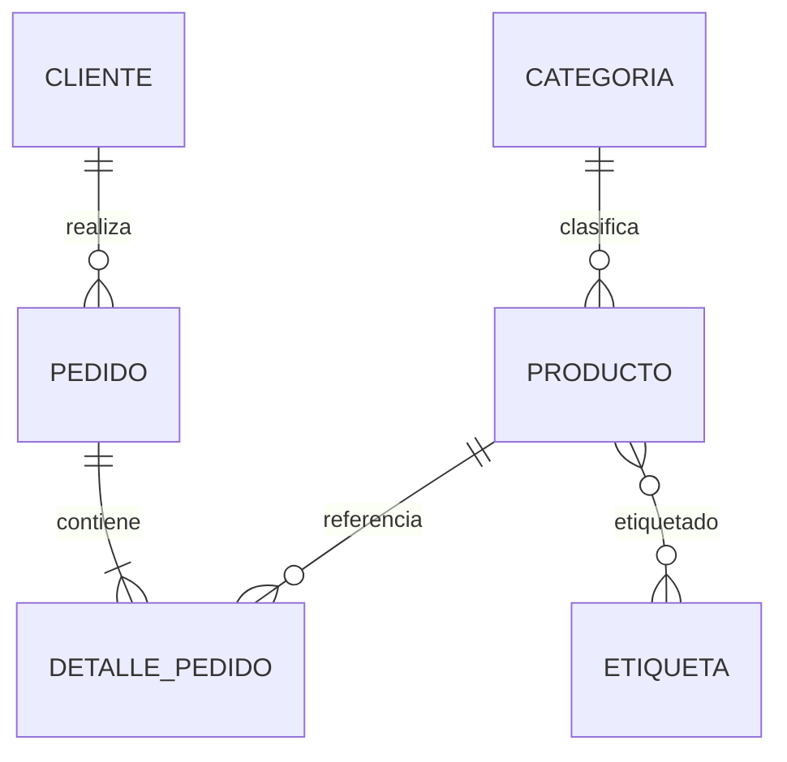

# Informe de Proyecto de Software · Capítulo 4

## Persistencia de Datos, Mapeo ORM, Pruebas con Fixtures e Interfaz Gráfica

| Campo | Detalle |
|---|---|
| **Institución / curso** | Construcción de Software |
| **Trabajo** | Instructivo de Trabajo Colaborativo N° 04 |
| **Empresa aliada** | **OPTIFIBER** · venta de productos FTTH |
| **PBI** | PBI-02 · Persistencia de clientes, pedidos y catálogo FTTH + PBI-03 · Interfaz gráfica de escritorio |
| **Repositorio** | `optifiber-ftth` (GitHub del equipo) |
| **Rama del PBI** | `feature/PBI-02-orm-persistencia` y `feature/PBI-03-interfaz-grafica` |
| **Stack** | Python 3.12+ · SQLAlchemy 2.x · SQLite · CustomTkinter · pytest · Ruff · GitHub Actions |
| **Fecha** | 28 de octubre de 2026 |

### Integrantes

| Integrante | Rol | GitHub sugerido |
|---|---|---|
| Huallpayunca Carrion Omar Sebastian | Git Master + Product Owner / Scrum Master | `@omarhuallpayunca` |
| Kevin Jesus Llerena Fernandez | Lead Backend Engineer | `@kevinllerena` |
| Amaru Josue Ai-me Yunguri | Database & ORM Specialist | `@amaruaime` |
| Julio Cesar Diaz Tito | DevOps & QA + Frontend/UX/UI | `@juliodiaz` |

> **Nota:** los usuarios de GitHub son sugeridos; deben reemplazarse por los usuarios reales antes de publicar el repositorio.

---

## Resumen ejecutivo

OPTIFIBER necesita registrar su operación comercial de productos FTTH: clientes, catálogo, pedidos y líneas de detalle. El PBI-02 implementa esa persistencia con SQLAlchemy 2.x sobre SQLite, manteniendo la lógica de negocio en `src/dominio` y la infraestructura en `src/infraestructura`. El diseño incluye seis entidades, relaciones 1:N, una relación N:M pura (`Producto`–`Etiqueta`) y una relación N:M con datos adicionales (`Pedido`–`Producto` mediante `DetallePedido`), reglas de cascada y restricciones de integridad.

La solución se desarrolló con ciclos TDD **RED → GREEN → REFACTOR** y un fixture de base de datos en memoria (`sqlite:///:memory:`) que garantiza pruebas herméticas. La suite final tiene **23 pruebas aprobadas** (21 de persistencia y dominio + 2 de datos demo), Ruff no reporta errores y el workflow de GitHub Actions instala las dependencias, ejecuta Ruff y pytest. La CLI permite demostrar el flujo completo: catálogo, alta de clientes, pedido con descuento de stock, reporte y eliminación en cascada.

Sobre esa base, el **PBI-03** incorpora una aplicación de escritorio con **CustomTkinter**: cinco pantallas funcionales, tema oscuro minimalista, formularios modales, punto de venta con carrito, reportes con exportación CSV y pedidos de demostración idempotentes. La GUI reutiliza los repositorios y las reglas de negocio, por lo que no duplica la lógica ni altera la suite existente.

---

# 4.1 Modelo Entidad-Relación (ERD)

## 4.1.1 Objetivo del modelo

Diseñar un esquema relacional que represente el negocio de OPTIFIBER y permita:

1. Identificar de forma única a cada cliente por DNI o RUC.
2. Clasificar productos FTTH por categoría y etiquetas comerciales.
3. Registrar pedidos con varias líneas, conservando el precio unitario histórico.
4. Controlar el stock y calcular totales con descuento por volumen.
5. Eliminar un cliente junto con sus pedidos y detalles sin dejar registros huérfanos.

## 4.1.2 Entidades del modelo

| Entidad | Rol en el negocio | Clave primaria | Claves foráneas | Campos clave |
|---|---|---|---|---|
| **CLIENTE** | Persona natural o empresa que compra en OPTIFIBER. | `id` | — | `nombre`, `documento` (UNIQUE), `telefono`, `email`, `direccion`, `creado_en` |
| **PEDIDO** | Orden de compra realizada por un cliente. | `id` | `cliente_id → clientes.id` | `fecha`, `estado`, `total` |
| **DETALLE_PEDIDO** | Línea del pedido; relaciona un pedido con un producto y guarda cantidad, precio y subtotal. | `id` | `pedido_id → pedidos.id`, `producto_id → productos.id` | `cantidad`, `precio_unitario`, `subtotal`; UNIQUE(`pedido_id`, `producto_id`) |
| **PRODUCTO** | Artículo FTTH que vende OPTIFIBER. | `id` | `categoria_id → categorias.id` | `sku` (UNIQUE), `nombre`, `precio`, `stock`, `activo` |
| **CATEGORIA** | Agrupación comercial del catálogo. | `id` | — | `nombre` (UNIQUE), `descripcion` |
| **ETIQUETA** | Clasificación transversal del producto (hogar, empresa, promoción, etc.). | `id` | — | `nombre` (UNIQUE) |
| **PRODUCTO_ETIQUETA** | Tabla de asociación N:M entre producto y etiqueta. | (`producto_id`, `etiqueta_id`) | `producto_id → productos.id`, `etiqueta_id → etiquetas.id` | — |

## 4.1.3 Relaciones y cardinalidad

| Relación | Cardinalidad | Implementación ORM | Regla de integridad |
|---|---|---|---|
| Cliente — Pedido | **1:N** | `ClienteModel.pedidos` ↔ `PedidoModel.cliente` con `back_populates`. | `cascade="all, delete-orphan"`; FK `clientes.id` con `ondelete="CASCADE"`. |
| Pedido — DetallePedido | **1:N** | `PedidoModel.detalles` ↔ `DetallePedidoModel.pedido`. | `cascade="all, delete-orphan"`; FK `pedidos.id` con `ondelete="CASCADE"`. |
| Categoría — Producto | **1:N** | `CategoriaModel.productos` ↔ `ProductoModel.categoria`. | Sin cascada; FK `categorias.id` con `ondelete="RESTRICT"` para no borrar productos por accidente. |
| Producto — DetallePedido | **1:N** | `ProductoModel.detalles` ↔ `DetallePedidoModel.producto`. | Sin cascada; FK `productos.id` con `ondelete="RESTRICT"` para preservar el historial. |
| Producto — Etiqueta | **N:M** | `ProductoModel.etiquetas` ↔ `EtiquetaModel.productos` con `secondary=producto_etiqueta`. | Tabla de asociación con PK compuesta y `ondelete="CASCADE"`. |
| Pedido — Producto | **N:M con atributos** | Se resuelve con `DetallePedidoModel` (cantidad, precio unitario, subtotal). | UNIQUE(`pedido_id`, `producto_id`) evita duplicar el mismo producto en un pedido. |

## 4.1.4 Diagrama ERD


**Figura 1.** Modelo Entidad-Relación de OPTIFIBER con las seis entidades, claves, relaciones y reglas de cascada.

## 4.1.5 Código fuente Mermaid



El archivo editable está en `docs/erd_optifiber.mmd` y la imagen en `docs/erd_optifiber.png`. La imagen se genera con `python scripts/generar_erd.py`.

## 4.1.6 Diccionario de datos

### CLIENTE

| Campo | Tipo | Restricción | Descripción |
|---|---|---|---|
| `id` | Integer | PK, autoincremental | Identificador interno. |
| `nombre` | String(120) | NOT NULL | Nombre o razón social. |
| `documento` | String(20) | NOT NULL, UNIQUE, INDEX | DNI (8 dígitos) o RUC (11 dígitos). |
| `telefono` | String(20) | NOT NULL, default `""` | Teléfono de contacto. |
| `email` | String(120) | NOT NULL, default `""` | Correo electrónico. |
| `direccion` | String(200) | NOT NULL, default `""` | Dirección de instalación o facturación. |
| `creado_en` | DateTime | NOT NULL | Fecha y hora de registro. |

### PEDIDO

| Campo | Tipo | Restricción | Descripción |
|---|---|---|---|
| `id` | Integer | PK, autoincremental | Identificador del pedido. |
| `fecha` | Date | NOT NULL, default `date.today` | Fecha del pedido. |
| `estado` | String(20) | NOT NULL, default `PENDIENTE` | PENDIENTE, PAGADO, ENVIADO o CANCELADO. |
| `total` | Float | NOT NULL, CHECK ≥ 0 | Total calculado con descuento. |
| `cliente_id` | Integer | FK, NOT NULL, INDEX | Cliente que realizó el pedido. |

### DETALLE_PEDIDO

| Campo | Tipo | Restricción | Descripción |
|---|---|---|---|
| `id` | Integer | PK, autoincremental | Identificador de la línea. |
| `pedido_id` | Integer | FK, NOT NULL | Pedido al que pertenece. |
| `producto_id` | Integer | FK, NOT NULL | Producto vendido. |
| `cantidad` | Integer | NOT NULL, CHECK > 0 | Unidades solicitadas. |
| `precio_unitario` | Float | NOT NULL, CHECK ≥ 0 | Precio histórico al momento de la venta. |
| `subtotal` | Float | NOT NULL, CHECK ≥ 0 | `cantidad × precio_unitario` redondeado. |
| — | — | UNIQUE(`pedido_id`, `producto_id`) | Evita duplicar el producto en el pedido. |

### PRODUCTO

| Campo | Tipo | Restricción | Descripción |
|---|---|---|---|
| `id` | Integer | PK, autoincremental | Identificador interno. |
| `sku` | String(20) | NOT NULL, UNIQUE, INDEX | Código comercial único. |
| `nombre` | String(120) | NOT NULL | Nombre del producto. |
| `descripcion` | String(300) | NOT NULL, default `""` | Detalle comercial. |
| `precio` | Float | NOT NULL, CHECK ≥ 0 | Precio de venta en soles. |
| `stock` | Integer | NOT NULL, CHECK ≥ 0 | Unidades disponibles. |
| `activo` | Boolean | NOT NULL, default `True` | Indica si se muestra en catálogo. |
| `categoria_id` | Integer | FK, NOT NULL | Categoría del producto. |

### CATEGORIA / ETIQUETA / PRODUCTO_ETIQUETA

| Entidad | Campo | Tipo | Restricción | Descripción |
|---|---|---|---|---|
| CATEGORIA | `id` | Integer | PK | Identificador. |
| CATEGORIA | `nombre` | String(80) | NOT NULL, UNIQUE | Nombre de la categoría. |
| CATEGORIA | `descripcion` | String(200) | NOT NULL, default `""` | Descripción. |
| ETIQUETA | `id` | Integer | PK | Identificador. |
| ETIQUETA | `nombre` | String(50) | NOT NULL, UNIQUE | Etiqueta comercial. |
| PRODUCTO_ETIQUETA | `producto_id` | Integer | PK, FK | Producto asociado. |
| PRODUCTO_ETIQUETA | `etiqueta_id` | Integer | PK, FK | Etiqueta asociada. |

## 4.1.7 Decisiones de diseño

1. **Claves primarias subrogadas:** se usa `id` autoincremental para todas las entidades; el `documento` del cliente y el `sku` del producto son claves naturales con restricción `UNIQUE`.
2. **Precio histórico:** `DetallePedido.precio_unitario` guarda el precio al momento de la venta; si el producto cambia de precio, el historial no se altera.
3. **N:M pura:** `Producto`–`Etiqueta` se implementa con `Table(...)` y `relationship(secondary=...)`, tal como pide el instructivo para relaciones N:M sin atributos.
4. **N:M con atributos:** `Pedido`–`Producto` se resuelve con `DetallePedidoModel`, que además permite cantidades, precios y subtotales.
5. **Cascada selectiva:** solo se propaga la eliminación a datos dependientes del pedido. Categorías y productos usan `RESTRICT` para no borrar información maestra por accidente.
6. **Integridad en SQLite:** el engine activa `PRAGMA foreign_keys=ON` en cada conexión; sin esto, SQLite no aplica las claves foráneas.
7. **Separación de capas:** el ERD y los modelos viven en infraestructura; las reglas de totales, descuentos y stock viven en `src/dominio`.

---

# 4.2 Código del modelo ORM

## 4.2.1 Clase base y tabla de asociación N:M

```python
# src/infraestructura/modelos.py
class Base(DeclarativeBase):
    """Clase base declarativa para todas las entidades ORM."""


producto_etiqueta = Table(
    "producto_etiqueta",
    Base.metadata,
    Column(
        "producto_id",
        Integer,
        ForeignKey("productos.id", ondelete="CASCADE"),
        primary_key=True,
    ),
    Column(
        "etiqueta_id",
        Integer,
        ForeignKey("etiquetas.id", ondelete="CASCADE"),
        primary_key=True,
    ),
)
```

La tabla de asociación se declara **antes** de las clases que la referencian, tal como exige SQLAlchemy para resolver `secondary`.

## 4.2.2 Relación 1:N Cliente–Pedido con cascada

```python
class ClienteModel(Base):
    __tablename__ = "clientes"

    id: Mapped[int] = mapped_column(Integer, primary_key=True, autoincrement=True)
    nombre: Mapped[str] = mapped_column(String(120), nullable=False)
    documento: Mapped[str] = mapped_column(
        String(20), nullable=False, unique=True, index=True
    )
    telefono: Mapped[str] = mapped_column(String(20), nullable=False, default="")
    email: Mapped[str] = mapped_column(String(120), nullable=False, default="")
    direccion: Mapped[str] = mapped_column(String(200), nullable=False, default="")
    creado_en: Mapped[datetime] = mapped_column(
        DateTime, nullable=False, default=datetime.now
    )

    pedidos: Mapped[list["PedidoModel"]] = relationship(
        back_populates="cliente",
        cascade="all, delete-orphan",
        order_by="PedidoModel.id",
    )


class PedidoModel(Base):
    __tablename__ = "pedidos"
    __table_args__ = (
        CheckConstraint("total >= 0", name="ck_pedidos_total_no_negativo"),
    )

    id: Mapped[int] = mapped_column(Integer, primary_key=True, autoincrement=True)
    fecha: Mapped[date] = mapped_column(Date, nullable=False, default=date.today)
    estado: Mapped[str] = mapped_column(String(20), nullable=False, default="PENDIENTE")
    total: Mapped[float] = mapped_column(Float, nullable=False, default=0.0)
    cliente_id: Mapped[int] = mapped_column(
        Integer,
        ForeignKey("clientes.id", ondelete="CASCADE"),
        nullable=False,
        index=True,
    )

    cliente: Mapped[ClienteModel] = relationship(back_populates="pedidos")
```

**Explicación:** `cascade="all, delete-orphan"` indica que, al eliminar un `ClienteModel`, SQLAlchemy elimina sus `PedidoModel` asociados. `back_populates` mantiene navegable la relación inversa (`pedido.cliente`).

## 4.2.3 DetallePedido: N:M con atributos y segunda cascada

```python
class DetallePedidoModel(Base):
    __tablename__ = "detalle_pedidos"
    __table_args__ = (
        UniqueConstraint("pedido_id", "producto_id", name="uq_detalle_pedido_producto"),
        CheckConstraint("cantidad > 0", name="ck_detalle_cantidad_positiva"),
        CheckConstraint("precio_unitario >= 0", name="ck_detalle_precio_no_negativo"),
        CheckConstraint("subtotal >= 0", name="ck_detalle_subtotal_no_negativo"),
    )

    id: Mapped[int] = mapped_column(Integer, primary_key=True, autoincrement=True)
    pedido_id: Mapped[int] = mapped_column(
        Integer,
        ForeignKey("pedidos.id", ondelete="CASCADE"),
        nullable=False,
        index=True,
    )
    producto_id: Mapped[int] = mapped_column(
        Integer,
        ForeignKey("productos.id", ondelete="RESTRICT"),
        nullable=False,
        index=True,
    )
    cantidad: Mapped[int] = mapped_column(Integer, nullable=False)
    precio_unitario: Mapped[float] = mapped_column(Float, nullable=False)
    subtotal: Mapped[float] = mapped_column(Float, nullable=False)

    pedido: Mapped[PedidoModel] = relationship(back_populates="detalles")
    producto: Mapped[ProductoModel] = relationship(back_populates="detalles")
```

En `PedidoModel`, la colección se define con la segunda cascada:

```python
detalles: Mapped[list["DetallePedidoModel"]] = relationship(
    back_populates="pedido",
    cascade="all, delete-orphan",
    order_by="DetallePedidoModel.id",
)
```

Así, al eliminar un cliente se eliminan sus pedidos y, en cadena, los detalles de cada pedido.

## 4.2.4 Relación N:M Producto–Etiqueta

```python
class EtiquetaModel(Base):
    __tablename__ = "etiquetas"

    id: Mapped[int] = mapped_column(Integer, primary_key=True, autoincrement=True)
    nombre: Mapped[str] = mapped_column(String(50), nullable=False, unique=True)

    productos: Mapped[list["ProductoModel"]] = relationship(
        secondary=producto_etiqueta,
        back_populates="etiquetas",
    )


class ProductoModel(Base):
    __tablename__ = "productos"

    # ... campos ...
    etiquetas: Mapped[list[EtiquetaModel]] = relationship(
        secondary=producto_etiqueta,
        back_populates="productos",
    )
```

La navegación es bidireccional: `producto.etiquetas` y `etiqueta.productos`. La tabla intermedia no requiere modelo propio porque no tiene atributos adicionales.

## 4.2.5 Separación de capas

| Capa | Archivo | Responsabilidad | Dependencias |
|---|---|---|---|
| Dominio | `src/dominio/servicios.py` | Subtotal, descuento, stock, DNI/RUC; excepciones de negocio. | Solo biblioteca estándar (`decimal`). |
| Infraestructura | `src/infraestructura/modelos.py` | Mapeo ORM, relaciones, cascadas y restricciones. | SQLAlchemy. |
| Infraestructura | `src/infraestructura/repositorios.py` | Operaciones CRUD y transacciones; usa las reglas del dominio. | Dominio + modelos. |
| Infraestructura | `src/infraestructura/db.py` | Engine, sesión, creación de tablas y `PRAGMA foreign_keys`. | SQLAlchemy. |
| Presentación | `src/presentacion/cli.py` | Menú, entradas/salidas y formato; no calcula reglas de negocio. | Repositorios + dominio. |

La dirección de dependencias es `presentacion → infraestructura → dominio`. El dominio no importa SQLAlchemy, lo que permite probar las reglas sin base de datos.

---

# 4.3 Fixture y pruebas de repositorio con TDD

## 4.3.1 Fixture de base de datos en memoria

```python
# tests/conftest.py
import pytest
from sqlalchemy import create_engine, event
from sqlalchemy.orm import sessionmaker
from sqlalchemy.pool import StaticPool

from src.infraestructura.modelos import Base


@pytest.fixture(scope="function")
def db_session():
    """Sesion limpia de SQLite en memoria para cada prueba."""
    engine = create_engine(
        "sqlite:///:memory:",
        connect_args={"check_same_thread": False},
        poolclass=StaticPool,
    )

    @event.listens_for(engine, "connect")
    def _activar_claves_foraneas(dbapi_connection, _connection_record):
        cursor = dbapi_connection.cursor()
        cursor.execute("PRAGMA foreign_keys=ON")
        cursor.close()

    Base.metadata.create_all(bind=engine)
    session = sessionmaker(bind=engine, expire_on_commit=False)()

    try:
        yield session
    finally:
        session.rollback()
        session.close()
        engine.dispose()
```

**Por qué `StaticPool`:** SQLite en memoria crea una base distinta por conexión. `StaticPool` reutiliza una sola conexión para que `create_all`, la sesión y las consultas vean el mismo esquema. `scope="function"` garantiza una base limpia por prueba y evita contaminación entre casos.

## 4.3.2 Ciclos TDD ejecutados

| Ciclo | RED (prueba que falla) | GREEN (implementación) | REFACTOR | Resultado |
|---|---|---|---|---|
| 1. Cliente 1:N Pedido | `b292e8c` · `ImportError: cannot import name 'ClienteModel'` | `c368e49` · modelos Cliente/Pedido | `9268085` · Ruff | **1 passed** |
| 2. Cascada Cliente→Pedido | `33febea` · `IntegrityError: NOT NULL constraint failed: pedidos.cliente_id` | `72e423d` · `cascade="all, delete-orphan"` | `9268085` · Ruff | **2 passed** |
| 3. N:M Producto–Etiqueta y DetallePedido | `e397f22` · `ImportError: cannot import name 'CategoriaModel'` | `df33bcd` · catálogo, etiquetas y detalle | `9268085` · Ruff | **5 passed** |
| 4. Reglas de dominio | `0bf652a` · `ModuleNotFoundError: src.dominio.servicios` | `4f6d01c` · servicios de dominio | `9268085` · Ruff | **15 passed** |
| 5. Repositorios y pedidos | `417ed0f` · `ModuleNotFoundError: src.infraestructura.repositorios` | `27071a2` · repositorios + seed + CLI | `9268085` · Ruff | **21 passed** |

Las salidas completas de cada etapa están en `docs/evidencias/01_red_ciclo1.txt` … `11_ruff_refactor.txt`.

## 4.3.3 Inventario de pruebas

| Archivo | Cantidad | Casos |
|---|---:|---|
| `tests/test_persistencia_orm.py` | 5 | Guardar cliente con pedidos; cascada cliente→pedidos; N:M producto–etiqueta; cascada pedido→detalles; documento único. |
| `tests/test_dominio.py` | 10 | Subtotal con redondeo; total bajo el umbral; descuento por volumen; stock insuficiente; cantidades inválidas; DNI/RUC válidos e inválidos. |
| `tests/test_repositorios.py` | 6 | Alta de pedido con descuento de stock; descuento por volumen; stock insuficiente con rollback; documento duplicado; cascada desde repositorio; catálogo con categoría y etiquetas. |
| `tests/test_seed.py` | 2 | Carga inicial del catálogo sin duplicados; pedidos demo idempotentes con descuento de stock. |
| **Total** | **23** | Suite hermética sobre `sqlite:///:memory:`. |

## 4.3.4 Evidencia de ejecución

Salida de `python -m pytest -v` (extracto):

```text
tests/test_dominio.py ..........                                         [ 43%]
tests/test_persistencia_orm.py .....                                     [ 65%]
tests/test_repositorios.py ......                                        [ 91%]
tests/test_seed.py ..                                                    [100%]

============================== 23 passed in 0.19s ==============================
```

Salida de `python -m ruff check .`:

```text
All checks passed!
```

Salida de la demo `python -m src.main --demo` (extracto):

```text
Pedido #1 | 2026-10-28 | PENDIENTE | Inversiones Andinas SAC (20512345678)
  - Cable ADSS 12 hilos 500 m                x  2   S/ 890.00 =  S/ 1,780.00
  - Switch Gigabit 8 puertos                 x  1   S/ 260.00 =    S/ 260.00
  - Conector SC/APC                          x  4     S/ 4.50 =     S/ 18.00
  TOTAL: S/ 1,955.10

[CASCADA] Cliente temporal eliminado; pedido dependiente eliminado: SI.
[OK] Demo finalizada. La persistencia, las relaciones y la cascada funcionan.
```

## 4.3.5 Pipeline de GitHub Actions

```yaml
name: CI - Calidad y Pruebas
on:
  push:
    branches: [main, dev, "feature/**"]
  pull_request:
    branches: [main, dev]
jobs:
  calidad:
    runs-on: ubuntu-latest
    steps:
      - uses: actions/checkout@v4
      - uses: actions/setup-python@v5
        with:
          python-version: "3.12"
          cache: pip
      - run: |
          python -m pip install --upgrade pip
          pip install -r requirements.txt
      - run: ruff check .
      - run: pytest -v
```

`requirements.txt` declara `SQLAlchemy>=2.0,<3.0`, `customtkinter>=5.2,<7.0` y `pillow>=10.0,<14.0`, por lo que el pipeline instala el ORM y la interfaz gráfica antes de ejecutar las pruebas.

## 4.3.6 Pull Request, revisión y merge

- Rama de trabajo: `feature/PBI-02-orm-persistencia`.
- Pull Request: **#2** (abrir el enlace del repositorio en GitHub; completar la URL al publicar).
- Revisión: Git Master (Omar Huallpayunca).
- Merge: **`329b4ea`** (`--no-ff`) hacia `main`, conservando la secuencia TDD.
- Tag de entrega: **`pbi-02-v1.0`**.
- Checks esperados: **Ruff** y **Pytest** en verde.
- PBI-03: rama `feature/PBI-03-interfaz-grafica`, commits `37b0a15` (GUI) y `f2bf169` (datos demo); merge `--no-ff` y tag `pbi-03-gui-v1.0` al cierre.
- El repositorio local ya contiene el historial completo; la guía de publicación está en `docs/GUIA_GIT_Y_ENTREGA.md`.

---

# 4.4 Interfaz gráfica de escritorio

## 4.4.1 Objetivo y decisiones de diseño

El PBI-02 dejó una capa de persistencia sólida, pero su uso diario dependía de la terminal. El PBI-03 añade una **aplicación de escritorio funcional** para que el asesor comercial pueda operar el sistema con mouse y teclado, sin escribir comandos. Se eligió **CustomTkinter** por ser una extensión moderna de Tkinter, ligera, multiplataforma y fácil de instalar en el entorno del curso.

Decisiones principales:

- **Tema oscuro minimalista:** fondo `#070B10`, paneles `#0E151E`, texto claro `#F4F7FB` y acento turquesa `#2DD4BF`.
- **Pocas imágenes:** la identidad visual se resuelve con tipografía, tarjetas, píldoras de estado y un icono propio; las capturas se usan solo como evidencia.
- **Reutilización de capas:** la GUI llama a `ClienteRepositorio`, `CatalogoRepositorio` y `PedidoRepositorio`; las reglas de totales, descuento, stock y documento siguen en `src/dominio`.
- **Terminal conservada:** `python -m src.main --cli` y `python -m src.main --demo` mantienen el flujo anterior para demostraciones y automatización.
- **Primer arranque útil:** `sembrar_pedidos_demo()` crea pedidos de ejemplo de forma idempotente (cliente + estado + líneas) para que el panel tenga actividad sin duplicar datos.

## 4.4.2 Pantallas implementadas

| Pantalla | Componentes principales | Operaciones |
|---|---|---|
| **Panel general** | Cuatro KPI, lista de pedidos recientes, alerta de stock bajo | Consultar el estado del negocio y navegar a otras pantallas |
| **Catálogo** | Búsqueda, filtro por categoría, tabla, modales de producto y categoría | Crear categorías y productos con etiquetas |
| **Clientes** | Buscador, directorio, ficha con historial | Crear clientes, ver historial y eliminar con cascada |
| **Pedidos** | Selector de cliente, catálogo, carrito, resumen de totales | Armar pedidos, validar stock, confirmar venta y cambiar estado |
| **Reportes** | KPIs, ventas por estado, top de productos, inventario por categoría | Analizar ventas y exportar un CSV |

La navegación lateral resalta la pantalla activa y la barra superior muestra el título, la fecha y un botón de refresco. Los atajos `Ctrl+1` … `Ctrl+5` cambian de pantalla y `F5` recarga la vista actual.


**Figura G1.** Panel general con indicadores, pedidos recientes y alertas de stock.


**Figura G2.** Punto de venta con cliente, catálogo, carrito y resumen de totales.


**Figura G3.** Reportes con ventas por estado, ranking de productos e inventario por categoría.

Las capturas restantes (catálogo, clientes, modales de producto, pedido y ficha de cliente) están en `docs/evidencias/gui/`.

## 4.4.3 Flujo funcional validado

Además de las pruebas automatizadas, se ejecutó una prueba de humo sobre la GUI real con una base temporal:

1. Alta de una categoría desde el modal de catálogo.
2. Alta de un producto `TST-001` con precio, stock, categoría y etiquetas.
3. Alta de un cliente con documento válido.
4. Selección del cliente, dos unidades del producto en el carrito y confirmación del pedido.
5. Verificación del total (`S/ 199.80`) y del descuento de stock.
6. Cambio del pedido a estado `PAGADO` desde el modal de detalle.
7. Exportación del reporte a CSV.

El flujo terminó sin errores y confirmó que la interfaz escribe en SQLite a través de los mismos repositorios del PBI-02.

## 4.4.4 Estructura de la interfaz

```text
src/presentacion/gui/
├── app.py            # Ventana principal, barra lateral, barra superior y routing
├── tema.py           # Paleta, tipografías y radios
├── componentes.py    # Tarjetas, tablas, botones, campos, modales y toasts
├── utilidades.py     # Moneda, fechas, iniciales y colores semánticos
└── pantallas/
    ├── dashboard.py
    ├── catalogo.py
    ├── clientes.py
    ├── pedidos.py
    └── reportes.py
```

La ventana principal crea una única sesión SQLAlchemy, inicializa el esquema, siembra los datos y comparte los repositorios con todas las pantallas. Al cerrar, cierra la sesión y libera el engine.

## 4.4.5 Resultado

La aplicación se abre con `python -m src.main`, muestra el panel general y permite completar el ciclo comercial completo sin terminal. La suite total queda en **23 pruebas aprobadas** y Ruff no reporta errores. La CLI sigue disponible como modo alternativo.

---

# 4.5 Conclusiones

1. **El ERD refleja el negocio real:** cliente, pedido, detalle, producto, categoría y etiqueta cubren el flujo comercial de OPTIFIBER sin tablas innecesarias.
2. **La separación de capas funcionó:** las reglas de negocio se probaron sin base de datos y los modelos ORM se probaron con SQLite en memoria.
3. **La cascada es segura y explícita:** eliminar un cliente elimina sus pedidos y detalles; en cambio, categorías y productos se protegen con `RESTRICT`.
4. **El fixture hermético evita efectos colaterales:** cada prueba recibe una base nueva; no depende de `data/optifiber.db` ni del orden de ejecución.
5. **El TDD dejó evidencia verificable:** cada ciclo tiene un commit RED que falla por la razón esperada y un commit GREEN que lo resuelve.
6. **La solución es funcional:** la CLI permite registrar clientes y pedidos, consultar el historial, ver reportes y comprobar la cascada.
7. **La calidad está automatizada:** Ruff y pytest se ejecutan localmente y en GitHub Actions; el pipeline falla si alguna prueba o regla de estilo se rompe.
8. **La GUI reutiliza la arquitectura:** las pantallas llaman a los repositorios existentes y las reglas de negocio permanecen en `src/dominio`, sin duplicar lógica.
9. **La experiencia de escritorio quedó completa:** panel, catálogo, clientes, pedidos, reportes, formularios modales y exportación CSV cubren el flujo comercial sin terminal.

### Lecciones aprendidas

- Declarar la tabla de asociación antes de las clases evita el error de resolución de `secondary`.
- `StaticPool` es necesario para que SQLite en memoria mantenga el esquema entre la creación y la sesión de prueba.
- `PRAGMA foreign_keys=ON` es imprescindible para que SQLite respete las claves foráneas.
- La cascada ORM debe combinarse con una decisión de negocio: no todo debe borrarse en cascada.
- Los precios históricos en `DetallePedido` protegen la facturación ante cambios de catálogo.

---

# 4.6 Lista de verificación para el docente

| N° | Criterio | Evidencia | Estado |
|---:|---|---|---|
| 1 | Modelo ERD e infraestructura ORM | §4.1, `src/infraestructura/modelos.py`, `docs/erd_optifiber.png` | ✅ |
| 2 | Fixture de base de datos en memoria | `tests/conftest.py` con `sqlite:///:memory:` y `StaticPool` | ✅ |
| 3 | Pruebas de persistencia 1:N y cascada en verde | `23 passed`; §4.3.2 y §4.3.4 | ✅ |
| 4 | Historial de commits RED → GREEN → REFACTOR | `git log --graph --oneline`; `docs/evidencias/commits.md` | ✅ |
| 5 | Pull Request y GitHub Actions | `.github/workflows/ci.yml`; PR #2 y merge `--no-ff` | ✅ |
| 6 | Capítulo 4 del informe completo | Este documento + `docs/Informe_Capitulo_4_OptiFiber.docx` | ✅ |
| 7 | Aplicación funcional con interfaz gráfica | §4.4, `src/presentacion/gui/` y `docs/evidencias/gui/` | ✅ |

---

# Anexo A · PBI-02

| Campo | Valor |
|---|---|
| **Historia** | Como asesor comercial de OPTIFIBER deseo registrar clientes, productos y pedidos con sus líneas de detalle para consultar el historial, controlar el stock y calcular el total con descuentos. |
| **Criterios** | Guardar cliente con pedidos; eliminar cliente en cascada; consultar producto con etiquetas; registrar pedido con detalle y stock; rechazar stock insuficiente; documento único. |
| **Rama** | `feature/PBI-02-orm-persistencia` |
| **Estado** | Terminado · fusionado a `main` |
| **Pruebas** | 21 aprobadas al cierre del PBI-02 |
| **Evidencias** | `docs/evidencias/` |

# Anexo B · Distribución del equipo

| Integrante | Rol | Aporte principal |
|---|---|---|
| Omar Huallpayunca | Git Master + PO/SM | Repositorio, PBI, revisión, merges, tags e informe. |
| Kevin Llerena | Lead Backend | Dominio, repositorios, reglas de negocio. |
| Amaru Ai-me | Database & ORM | ERD, modelos, relaciones, cascadas y restricciones. |
| Julio Diaz | DevOps & QA + Frontend | Fixture, pruebas, Ruff, CI, GUI CustomTkinter y evidencias. |

El detalle está en `docs/DISTRIBUCION_EQUIPO.md`.

# Anexo C · PBI-03

| Campo | Valor |
|---|---|
| **Historia** | Como asesor comercial de OPTIFIBER deseo gestionar clientes, productos, pedidos y reportes desde una aplicación de escritorio para operar sin depender de la terminal. |
| **Criterios** | Abrir la GUI por defecto; navegar entre cinco pantallas; crear productos y clientes; registrar pedidos con stock; cambiar estados; eliminar clientes en cascada; exportar reportes. |
| **Rama** | `feature/PBI-03-interfaz-grafica` |
| **Estado** | Terminado · fusionado a `main` |
| **Pruebas** | 23 aprobadas en total (21 del PBI-02 + 2 de datos demo) |
| **Evidencias** | `docs/evidencias/gui/` |

---

# Referencias

- SQLAlchemy Documentation. *ORM Declarative Mapping* y *Relationship Configuration*. https://docs.sqlalchemy.org/
- pytest Documentation. *Fixtures* y *Temporary directories*. https://docs.pytest.org/
- Ruff Documentation. *Linter and formatter*. https://docs.astral.sh/ruff/
- GitHub Docs. *GitHub Actions workflow syntax*. https://docs.github.com/actions
- Instructivo de Trabajo Colaborativo N° 04. *Persistencia de Datos, Mapeo ORM y Pruebas con Fixtures*. Curso Construcción de Software.
